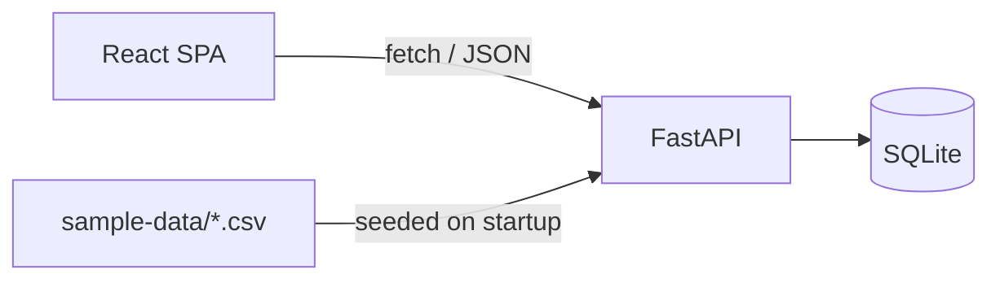
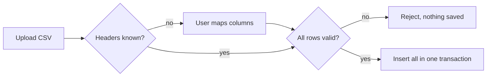

# Design

## Architecture



- **Frontend:** display, filters, upload/mapping forms. No calculations.
- **Backend:** validation, import, all calculations, audit.
- One process, one database file. No external services.

## Planned files

```
backend/
  main.py          routes, summary calculations, startup seeding
  db.py            sqlite3 connection + schema
  importer.py      CSV parsing, aliases, mapping, validation (pure functions)
  requirements.txt
  tests/           pytest (temp DB)
frontend/src/
  App.tsx          nav + dataset state
  Overview.tsx  History.tsx  HowItWorks.tsx
  api.ts           fetch helpers + types
  styles.css
sample-data/
  generate.py      fixed-seed generator
  household.csv  small-business.csv
```

## Dependencies

| Backend | Frontend |
|---------|----------|
| fastapi, uvicorn, python-multipart (uploads) | react, react-dom, recharts |
| pytest, httpx (TestClient) | vite 6, typescript, @vitejs/plugin-react |

Vite 6, not 7: the local Node version is 22.9 and Vite 7 needs 22.12 or later.

## Data flow



## Data model

| Table | Fields |
|-------|--------|
| `datasets` | dataset_id, name, file_sha256 (unique), created_at |
| `transactions` | transaction_id, dataset_id, date, company, category (nullable), direction, amount_cents (>0), currency (AUD) |
| `category_audit` | dataset_id, transaction_id, previous_category, new_category, changed_at |

## API

| Method | Path | Purpose |
|--------|------|---------|
| GET | `/api/categories` | Approved categories |
| GET | `/api/datasets` | List datasets |
| POST | `/api/datasets` | Upload CSV (+ optional mapping) |
| GET | `/api/datasets/{id}/summary?start&end` | Totals, monthly, by category, text |
| GET | `/api/datasets/{id}/transactions?start&end&category&direction` | Filtered list |
| PATCH | `/api/datasets/{id}/transactions/{tid}` | Set category (audited) |

- Mapping reuses `POST /api/datasets`: a response of `mapping_required` means resubmit with a `mapping` field.
- Errors: `{"detail": {"code", "message"}}`, e.g. `mapping_required`, `invalid_rows`, `duplicate_file`.

## CSV validation
- `.csv`, UTF-8, ≤ 2 MB, parsed in memory with stdlib `csv`.
- Small alias dict (e.g. `payee` → company); unknown headers → user maps.
- Date: `YYYY-MM-DD` or `DD/MM/YYYY`.
- Amount: positive, ≤ 2 decimals, `Decimal` → integer cents.
- Direction: in/credit → INCOMING, out/debit → OUTGOING, else reject.
- Category: blank → null; otherwise must be approved.
- All-or-nothing import; duplicate file hash or transaction ID rejected.

## Calculations
- Income = sum INCOMING; Expenses = sum OUTGOING; Net = Income − Expenses.
- Uncategorised always included.
- Integer cents only; fixed-template summary text.

## Human review
Uncategorised rows highlighted → user picks approved category → update + audit in one transaction → summary refreshes.

## Security
- Parameterised SQL, input validation, DB constraints.
- Uploads not stored; no transaction data in logs.
- No auth (local demo gap).

## Future AI (not implemented)
- **Categorisation:** AI suggests → validated against approved list → human approves → audited.
- **Summaries:** AI explains verified aggregates only; numbers checked; template fallback.

## Production (proposal only, not built)
CDN (frontend) → API gateway → FastAPI on a managed host → managed PostgreSQL. CI runs pytest and the frontend build before deploying. Secrets manager, central logging, OIDC auth.
